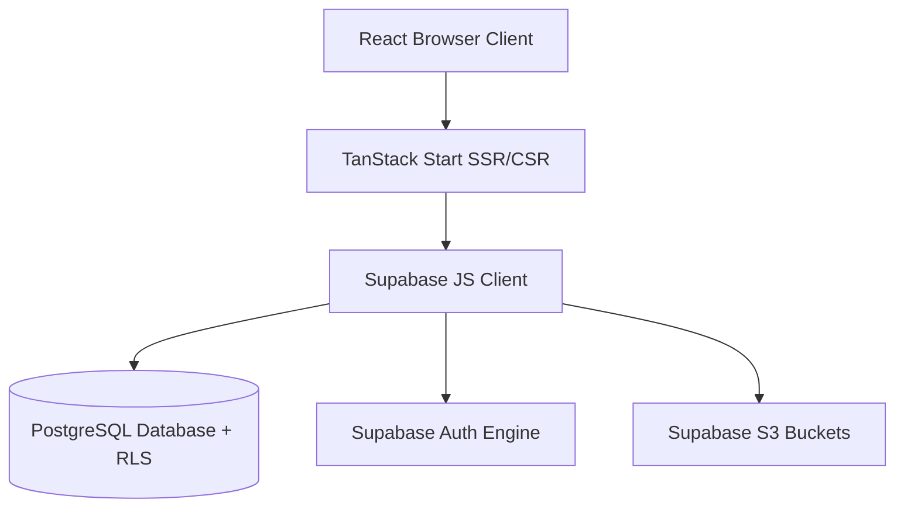

# Source2BD: Multi-Vendor B2B Sourcing Platform

[](https://opensource.org/licenses/MIT)
[](#technology-stack)
[](#technology-stack)
[](#technology-stack)

**Source2BD** is a modern B2B wholesale marketplace web platform connecting enterprises, local manufacturers, and verified suppliers. Engineered with TanStack Start, TypeScript, and Supabase for real-time order tracking, RFQ (Request for Quotation) workflows, and catalog indexing.

---

## ⚡ Technology Stack

- **Framework**: TanStack Start / Vite / React 18
- **Language**: TypeScript (Strict typing)
- **State & Routing**: TanStack Router & Query
- **UI & Design**: Tailwind CSS, Radix UI Primitives, Lucide Icons
- **Backend & Auth**: Supabase (PostgreSQL with Row Level Security, Storage, Auth)

---

## 🏗️ Architecture Overview



---

## 🚀 Setup & Local Development

### 1. Clone & Install Dependencies
```bash
git clone git@github.com:xtturan/source2bd.git
cd source2bd
bun install # or npm install
```

### 2. Configure Environment Variables
Copy `.env.example` to `.env` and provide your credentials:
```bash
cp .env.example .env
```
Fill in your Supabase project parameters:
```env
VITE_SUPABASE_URL=https://your-project.supabase.co
VITE_SUPABASE_PUBLISHABLE_KEY=your-publishable-key
```

### 3. Run Development Server
```bash
bun dev # or npm run dev
```
Open `http://localhost:3000` (or the configured Vite port) in your browser.

---

## 📄 License
This project is licensed under the [MIT License](LICENSE).
